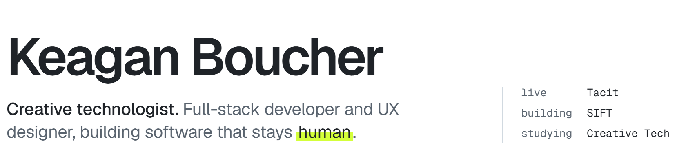
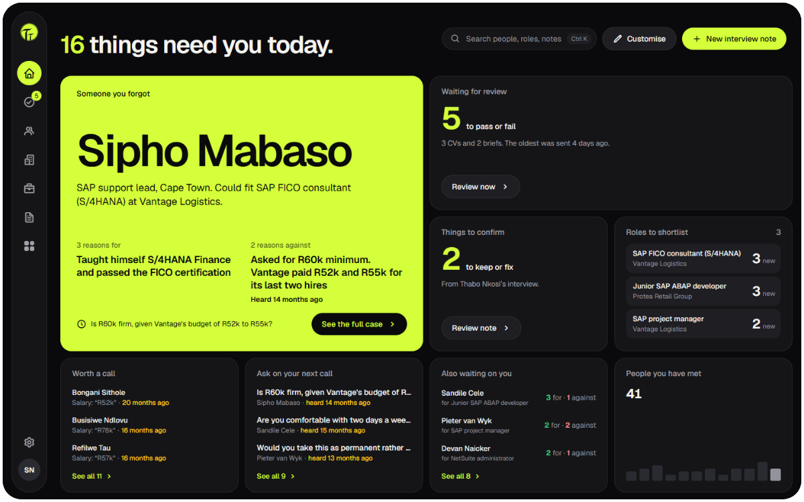
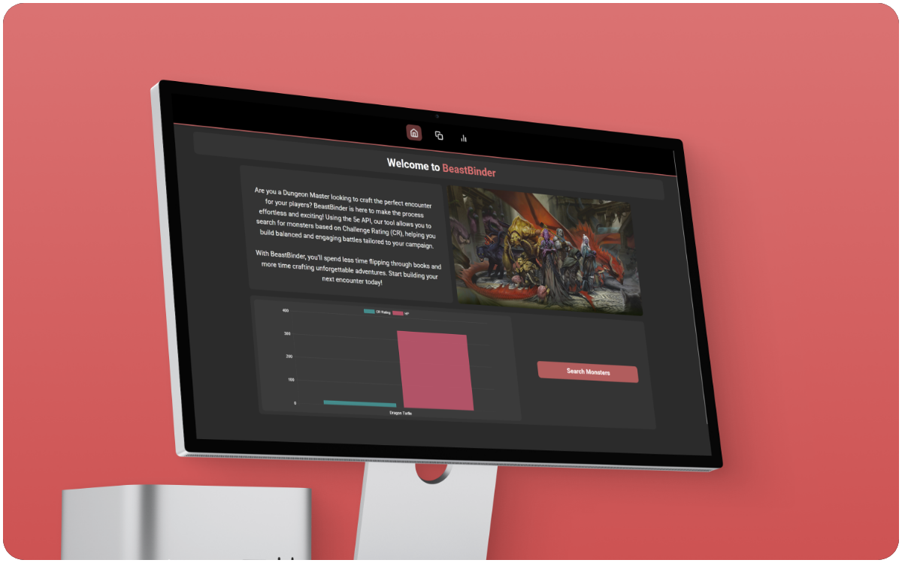
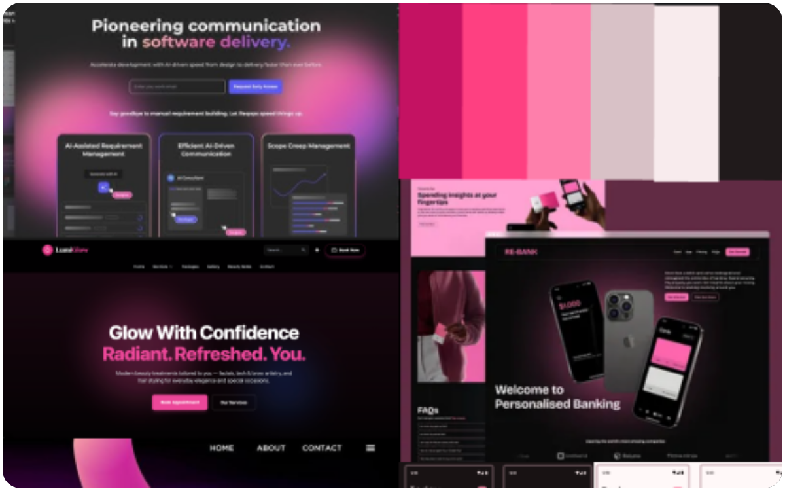

<picture>
  <source media="(prefers-color-scheme: dark)" srcset="assets/header-dark.png" />
  
</picture>

[LinkedIn](https://www.linkedin.com/in/keagan-boucher/) · [Email](mailto:keaganbouchergo@gmail.com) · [Tacit live demo](https://tacit.keaganboucher.com)

I'm a Creative Technologies student working where full-stack development meets UX. Most of what I build is a practical tool for a real workflow, recruiting, shopping, running a game, and I care as much about the empty states and the docs as the database underneath.

### Selected work

**[Tacit](https://github.com/Keagan-Boucher/Tacit-Recruitment-Dashboard)**: an AI recruiter dashboard that remembers what you learned in the interview. Notes become cited evidence, and briefs surface the right people with reasons for and against. [Live demo ›](https://tacit.keaganboucher.com) 
React 19 · TypeScript · Express 5 · Firebase · Groq

<table>
  <tr>
    <td width="50%" valign="top">
       
      <b><a href="https://github.com/Keagan-Boucher/SIFT">SIFT</a></b> in development 
      Price comparison for any retailer you name. Scrapes live, streams results in, explains what a good price is. 
      React Native · Expo · Firebase · Cheerio
    </td>
    <td width="50%" valign="top">
       
      <b><a href="https://github.com/Keagan-Boucher/Formative-One-BeastBinder">BeastBinder</a></b> 
      A D&amp;D 5e companion for Dungeon Masters to search, compare and chart monsters mid-session. 
      React · Vite · Chart.js · D&amp;D 5e API
    </td>
  </tr>
  <tr>
    <td width="50%" valign="top">
       
      <b><a href="https://github.com/Keagan-Boucher/Wine-E-commerce-site">Pour Decisions</a></b> group project 
      A boutique wine store with an experimental card-sequence second factor at login. 
      MongoDB · Express · React · Node · Material UI
    </td>
    <td width="50%" valign="top">
       
      <b><a href="https://github.com/Keagan-Boucher/SheIsDesign">She is Design</a></b> group project 
      A community platform for female design students in South Africa, with admin tools for events and galleries. 
      React · HTML · CSS
    </td>
  </tr>
</table>

### Toolbox

Always happy to talk recruitment tools, odd auth ideas, or D&amp;D monsters.
